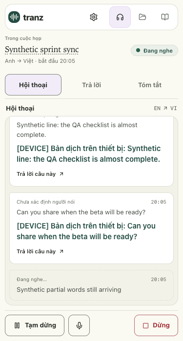
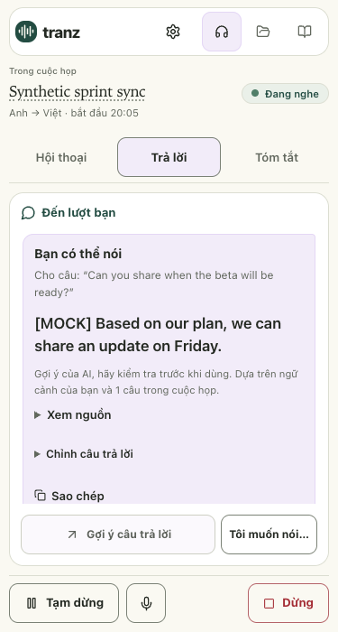
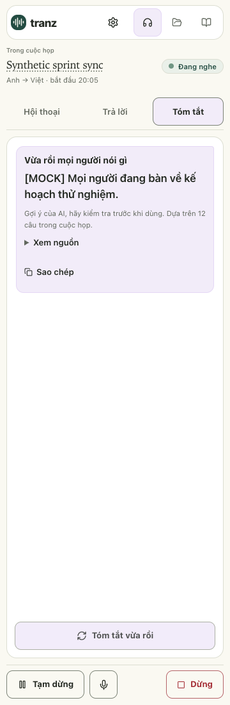
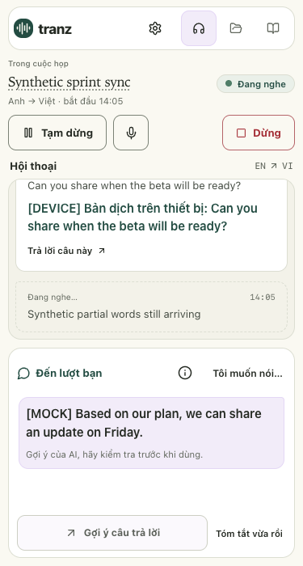
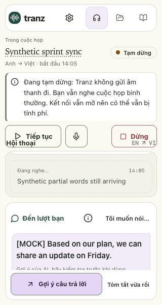
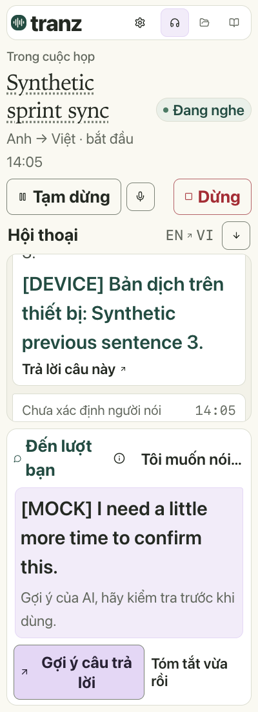
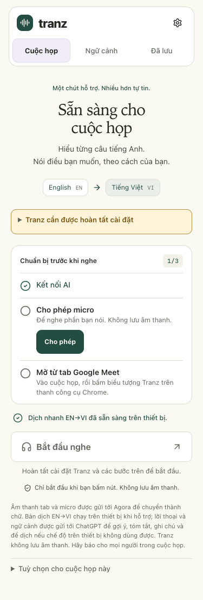

# Phase 08W — Làm lại UI/UX theo tham khảo Wispr Flow

Ngày: 2026-10-07. Nhánh: `feat/wispr-inspired-ui`. Điểm bắt đầu: `feat/chat-conversation`, commit `60e2cf4`.

Commit triển khai: `41f0d8c`. [Draft PR #15](https://github.com/doandanh-zah/tranz/pull/15), base `feat/chat-conversation`, đã push.

Người dùng yêu cầu làm lại UI/UX và tham khảo [Wispr Flow](https://wisprflow.ai/). Phạm vi là giao diện extension; yêu cầu mới thay thế hướng màu đen ở lần thiết kế trước. Không thay đổi hợp đồng runtime.

## Phản hồi mới nhất: tách nhiệm vụ thành từng mục

Người dùng làm rõ: không nhồi mọi tính năng vào một trang; chia thành nhiều phần để tinh gọn. Bản hiện tại thay thế cách ghép hội thoại và trả lời ở checkpoint trước.

- **Hội thoại** là mục mặc định, chỉ hiện lịch sử lời nói và bản dịch cùng nhau.
- **Trả lời** dành riêng cho câu được chọn/đoán được, gợi ý, soạn câu, nguồn, chỉnh văn phong và sao chép.
- **Tóm tắt** có kết quả riêng và nút yêu cầu AI rõ ràng. Chuyển mục không tự gửi yêu cầu AI.
- Chỉ một panel xuất hiện trong giao diện và cây accessibility. Trạng thái cùng Tạm dừng/Micro/Dừng nằm ngoài các mục, trong cùng viewport.
- “Trả lời câu này” chuyển sang Trả lời và đặt focus tại panel. Tablist hỗ trợ phím mũi tên, Home/End và một điểm Tab.
- Hội thoại được giữ mounted, nhận lời thoại/bản dịch khi mở mục khác, giữ vị trí đọc giữa lịch sử khi quay lại; follow/jump vẫn hoạt động. Gợi ý và tóm tắt giữ kết quả độc lập. Soạn câu giữ bản nháp trong dialog.

### Bằng chứng bản cuối

| Kiểm tra | Kết quả |
| --- | --- |
| `npm run verify` | Lint/types, 34/34 tests và build xác minh đạt |
| `npm run lint && npm run typecheck` sau sửa cuối | Đạt |
| `TRANZ_CHROMIUM='<Chromium 1234>' npm run verify:ui -- artifacts/ui-sections` | **147/147 đạt** trên extension unpacked thực |
| Layout từng mục | 320/360/375/400/414/480/600/768 px; một panel hiện, điều khiển vừa viewport; 320×600 đến 600×900 cho phần đọc/trả lời; chữ 200% tại 400×1100 |
| Hành vi | Giữ vị trí đọc khác 0, nhận câu khi panel ẩn, bàn phím/focus, nguồn/uncertainty, kết quả AI độc lập, bản nháp, reduced motion, states, quyền/pairing và flow mock hiện có đều đạt |
| `npm run build` | Đạt; `dist/extension` được cập nhật |
| Trình duyệt local | Đã chọn câu, xem gợi ý và mở mục Tóm tắt ở 375×700 trên demo có nhãn dữ liệu tổng hợp/mock |
| Diff và tài liệu | `git diff --check`, link Markdown local và quét credential marker trong nội dung thêm đạt |

[Kết quả 147 mục](wispr-ui/sections-results.json). Các ảnh là render bản unpacked với dữ liệu kiểm thử tổng hợp; [DEVICE]/[MOCK] không chứng minh chất lượng dịch hoặc AI thật.

File sửa: `apps/extension/src/views/Live.tsx`, `apps/extension/src/style.css`, `scripts/verify-ui.mjs`, `README.md`, `DESIGN.md`, `WORKFLOW.md`, `TODOS.md`, `CHANGELOG.md`, `.hallmark/log.json`, báo cáo này. Thêm ba ảnh và JSON kết quả ở `docs/evidence/wispr-ui/`.

Không sửa App, server, shared contracts, capture, Agora, provider/translator, auth, manifest, retention hoặc dữ liệu thật. Không dùng lại các phiên thật làm test. Giữ nguyên `.claude/` chưa tracked.

Nhánh vẫn `feat/wispr-inspired-ui`; cập nhật draft PR #15, không merge/release, không tăng VERSION, không chuyển phase. UI và xác minh local đã hoàn tất để review; native side panel, VoiceOver và các gate Meet thật vẫn pending. Nội dung dài cần cuộn trong mục tương ứng; chiều cao quá thấp ngoài các kích thước kiểm tra chưa được xác minh. Cảnh báo bundle offscreen khoảng 2.9 MB giữ nguyên.

Các mục bên dưới lưu bằng chứng của những checkpoint trước, không mô tả layout hiện tại.

## Kết quả

- Nền kem, vùng đọc sáng, nút tím nhạt, bản dịch xanh đậm; tiêu đề serif dùng font có sẵn trên máy.
- Header và điều hướng có lựa chọn rõ ràng. Trong phiên đang chạy, dùng hàng icon gọn với tên truy cập được và tooltip; màn chuẩn bị và màn phụ vẫn cuộn theo trang.
- Home có cặp ngôn ngữ, tiến độ chuẩn bị thật, lý do nút bắt đầu chưa dùng được và thời gian kết nối ở dòng riêng.
- Hội thoại giữ lịch sử, liên kết câu gốc với bản dịch, vị trí đọc và nút xuống câu mới nhất. Câu được chọn có viền/nền riêng và trạng thái truy cập được qua bàn phím.
- Khối “Đến lượt bạn” nhóm gợi ý, tóm tắt và soạn câu. Gợi ý AI vẫn có nguồn và cảnh báo kiểm tra.
- Ngữ cảnh, thư viện, cài đặt, ghi chú và lưu phiên dùng cùng một hệ thiết kế. Số câu và trạng thái ghi chú lấy từ dữ liệu thật.
- Trang demo luôn ghi “Bản xem thử · Hội thoại tổng hợp · AI mô phỏng”. Bản extension bình thường không có nhãn này.

## Phản hồi tiếp theo: nằm trong một màn hình khi họp

Người dùng yêu cầu không phải lướt cả trang trong lúc họp. Cùng Phase 08W và draft PR #15, màn đang họp nay chia theo chiều cao viewport: header gọn, thông tin phiên và điều khiển, vùng hội thoại, vùng hỗ trợ trả lời. Không dùng thanh nổi che lời thoại.

- Tạm dừng/tiếp tục, micro, Dừng, gợi ý, tóm tắt và soạn câu luôn nằm trong khung ở các kích thước đã kiểm tra. Lịch sử và nội dung dài cuộn riêng.
- Câu trả lời ngắn và cảnh báo AI hiện đầy đủ ngay trong khung. Nguồn, chỉnh câu, sao chép mở qua nút thông tin “Chi tiết gợi ý”.
- “Tôi muốn nói…” và tên ngữ cảnh mở dialog; Escape/Đóng trả focus về nút mở. Bản nháp chưa gửi được giữ lại; soạn thành công đóng dialog và hiện kết quả tại vùng trả lời. Lỗi soạn vẫn có thông báo trong dialog.
- Khi đang đọc lịch sử, giữ vị trí; nút mũi tên xuống ở đầu vùng hội thoại đưa về câu mới nhất. Khi đang theo dõi câu mới, thay đổi kích thước vùng đọc vẫn giữ ở cuối.
- Sau khi dừng, ghi chú và màn phụ tiếp tục cuộn bình thường. Không thay đổi audio, quyền, AI, backend, dữ liệu hay nguồn người nói.

Xác minh bản cuối:

| Kiểm tra | Kết quả |
| --- | --- |
| `npm run verify` | Lint/types, 34/34 tests và build xác minh đạt |
| Lint/types và `npm run build` sau thay đổi cuối | Đạt; `dist/extension` đã cập nhật |
| `TRANZ_CHROMIUM='<Chromium 1234>' npm run verify:ui -- artifacts/ui-one-screen` | **100/100 đạt** trên bản unpacked |
| Kiểm tra viewport | 320×600, 375×700, 400×800, 600×900: trang không cuộn; điều khiển và hành động trả lời nằm trong màn; câu trả lời ngắn và cảnh báo AI hiện đầy đủ |
| Trạng thái/phóng chữ | Chờ lời thoại, connecting, paused, reconnecting tại 320×600; chữ 200% tại 400×1100; dialog/focus, giữ nháp, lịch sử/follow đều đạt |
| Xem trong trình duyệt local | Đã thao tác gợi ý và mở/đóng composer tại 375×700 trên demo có nhãn mock/tổng hợp |

[Kết quả 100 mục](wispr-ui/one-screen-results.json). Ảnh dưới đây từ extension unpacked với dữ liệu tổng hợp, không phải cuộc họp thật.

Các file của phản hồi này: `App.tsx`, `Live.tsx`, `style.css`, `scripts/verify-ui.mjs`, `DESIGN.md`, `TODOS.md`, `CHANGELOG.md`, `README.md`, `WORKFLOW.md`, báo cáo và ảnh/JSON này. Nhánh vẫn là `feat/wispr-inspired-ui`; cập nhật cùng PR draft, không merge/release và không chuyển phase. Native side panel và VoiceOver còn pending. Nội dung quá dài vẫn cần cuộn trong vùng tương ứng; không khẳng định toàn bộ lịch sử hoặc mọi kích thước cực thấp đều đọc được cùng lúc.

## File thay đổi

- `tokens.css`; `apps/extension/index.html`; `apps/extension/src/App.tsx`, `components.tsx`, `main.tsx`, `style.css`.
- Các view: `Home.tsx`, `Live.tsx`, `ContextProfiles.tsx`, `Library.tsx`, `AfterMeeting.tsx`. Settings nhận hệ giao diện qua CSS chung, không đổi logic.
- `scripts/demo-ui.mjs`, `scripts/verify-ui.mjs`; metadata thiết kế `.hallmark/`.
- `README.md`, `DESIGN.md`, `WORKFLOW.md`, `TODOS.md`, `CHANGELOG.md`, báo cáo và ảnh này.

Không sửa server, shared contracts, capture, offscreen, Agora, translator, auth, manifest, retention, dữ liệu cá nhân hoặc `agora-baseline/`. `.claude/` là file chưa được theo dõi từ trước và được giữ nguyên.

## Lệnh và bằng chứng

| Kiểm tra | Kết quả |
| --- | --- |
| `npm run verify` | Lint, typecheck, 34/34 tests, build xác minh đạt |
| `npm run lint && npm run typecheck` sau chỉnh sửa cuối | Đạt |
| `TRANZ_CHROMIUM='<Chromium 1234>' npm run verify:ui -- artifacts/ui-wispr` | 73/73 mục đạt trên bản unpacked mới nhất |
| `npm run build` | Đạt; cập nhật `dist/extension` và `dist/server` |
| `npm run demo:ui -- --live` | Backend dùng mock AI/dữ liệu tổng hợp, HTTP 200 tại 127.0.0.1:5173; đã xem và thao tác trong trình duyệt |
| `git diff --check`, kiểm tra link Markdown và quét dấu hiệu secret trong thay đổi | Đạt trước commit |

Harness thực sự load extension unpacked và service worker, kiểm tra quyền không đổi, tự pairing, 320/360/375/400/414/480/600/768 px cho Home và Live, một số kích thước cho màn phụ, chữ 200%, focus/skip link, reduced motion, lịch sử/selection/follow, dịch local giả lập và fallback mock, composer, notes, giữ/xoá phiên và khôi phục offline. Kiểm tra tràn còn kiểm tra biên và nội dung của từng control để tránh che lỗi bằng overflow clipping. Không có script error.

Độ tương phản tính theo WCAG: chữ phụ trên nền trắng 5.74:1, chữ phụ trên lavender 4.96:1, bản dịch 9.62:1, nút chính 11.21:1, viền tương tác 3.96:1 và focus trên canvas 8.59:1. Đây là các cặp token đã kiểm tra, không phải chứng nhận toàn bộ accessibility.

Chromium đã dùng: `/Users/doandothanhdanh/Library/Caches/ms-playwright/chromium-1234/chrome-mac-arm64/Google Chrome for Testing.app/Contents/MacOS/Google Chrome for Testing`.

Lần chạy đầu bị chặn bởi dependency macOS `compressed,dataless`; cài lại bằng `npm ci` từ lockfile, không đổi dependency manifest/lockfile. Build vẫn cảnh báo offscreen bundle khoảng 2.9 MB, nằm ngoài phạm vi UI này.

## Ảnh của checkpoint thiết kế ban đầu

Toàn bộ lời thoại, account và AI trong ảnh là dữ liệu kiểm thử tổng hợp. Nhãn [DEVICE]/[MOCK] biểu thị translator/provider giả lập, không phải bằng chứng chất lượng dịch thật.

### Chuẩn bị · 375 px

### Hội thoại · 375 px

### Cài đặt · 360 px

Các ảnh bổ sung, kết quả JSON và thứ tự focus ở `artifacts/ui-wispr/` trên máy local.

## Trạng thái gate

Triển khai UI, phản hồi một màn hình và xác minh local hoàn tất; dừng để người dùng review. PR là bản draft vì kiểm tra thủ công khung side panel thật và VoiceOver còn pending. Không merge, release, tăng VERSION hoặc chuyển Phase 09.

Giới hạn còn giữ nguyên: lựa chọn capture chỉ đối phương ở Phase 08V chưa được chốt; không chứng minh nhận audio của người khác từ Meet, playback, phục hồi mất mạng hay chất lượng cuộc họp nhiều người. Không dùng kết quả mock để khẳng định các gate live này đạt.

Không thêm font/media bên ngoài, credential, dịch vụ tính phí hoặc đường lưu âm thanh mới.
