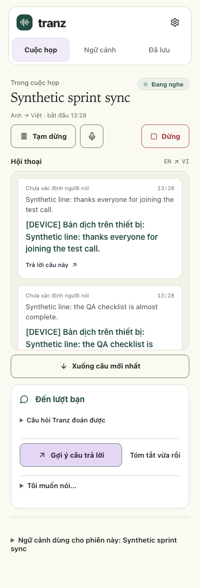
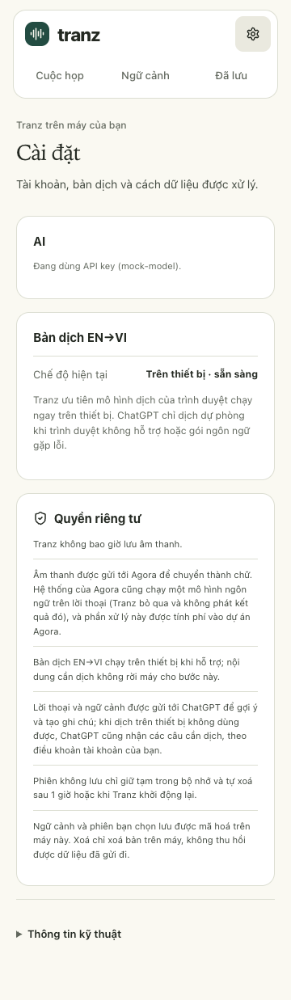

# Phase 08W — Làm lại UI/UX theo tham khảo Wispr Flow

Ngày: 2026-10-07. Nhánh: `feat/wispr-inspired-ui`. Điểm bắt đầu: `feat/chat-conversation`, commit `60e2cf4`.

Người dùng yêu cầu làm lại UI/UX và tham khảo [Wispr Flow](https://wisprflow.ai/). Phạm vi là giao diện extension; yêu cầu mới thay thế hướng màu đen ở lần thiết kế trước. Không thay đổi hợp đồng runtime.

## Kết quả

- Nền kem, vùng đọc sáng, nút tím nhạt, bản dịch xanh đậm; tiêu đề serif dùng font có sẵn trên máy.
- Header và điều hướng có lựa chọn rõ ràng, cuộn cùng nội dung. Khi chữ lớn, điều hướng chuyển sang các hàng đủ rộng.
- Home có cặp ngôn ngữ, tiến độ chuẩn bị thật, lý do nút bắt đầu chưa dùng được và thời gian kết nối ở dòng riêng.
- Hội thoại giữ lịch sử, liên kết câu gốc với bản dịch, vị trí đọc và nút xuống câu mới nhất. Câu được chọn có viền/nền riêng và trạng thái truy cập được qua bàn phím.
- Khối “Đến lượt bạn” nhóm gợi ý, tóm tắt và soạn câu. Gợi ý AI vẫn có nguồn và cảnh báo kiểm tra.
- Ngữ cảnh, thư viện, cài đặt, ghi chú và lưu phiên dùng cùng một hệ thiết kế. Số câu và trạng thái ghi chú lấy từ dữ liệu thật.
- Trang demo luôn ghi “Bản xem thử · Hội thoại tổng hợp · AI mô phỏng”. Bản extension bình thường không có nhãn này.

## File thay đổi

- `tokens.css`; `apps/extension/index.html`; `apps/extension/src/App.tsx`, `components.tsx`, `main.tsx`, `style.css`.
- Các view: `Home.tsx`, `Live.tsx`, `ContextProfiles.tsx`, `Library.tsx`, `AfterMeeting.tsx`. Settings nhận hệ giao diện qua CSS chung, không đổi logic.
- `scripts/demo-ui.mjs`, `scripts/verify-ui.mjs`; metadata thiết kế `.hallmark/`.
- `README.md`, `DESIGN.md`, `WORKFLOW.md`, `TODOS.md`, `CHANGELOG.md`, báo cáo và ảnh này.

Không sửa server, shared contracts, capture, offscreen, Agora, translator, auth, manifest, retention, dữ liệu cá nhân hoặc `agora-baseline/`. `.claude/` là file chưa được theo dõi từ trước và được giữ nguyên.

## Lệnh và bằng chứng

| Kiểm tra | Kết quả |
| --- | --- |
| `npm run verify` | Lint, typecheck, 34/34 tests, build xác minh đạt |
| `npm run lint && npm run typecheck` sau chỉnh sửa cuối | Đạt |
| `TRANZ_CHROMIUM='<Chromium 1234>' npm run verify:ui -- artifacts/ui-wispr` | 73/73 mục đạt trên bản unpacked mới nhất |
| `npm run build` | Đạt; cập nhật `dist/extension` và `dist/server` |
| `npm run demo:ui -- --live` | Backend dùng mock AI/dữ liệu tổng hợp, HTTP 200 tại 127.0.0.1:5173; đã xem và thao tác trong trình duyệt |
| `git diff --check`, kiểm tra link Markdown và quét dấu hiệu secret trong thay đổi | Đạt trước commit |

Harness thực sự load extension unpacked và service worker, kiểm tra quyền không đổi, tự pairing, 320/360/375/400/414/480/600/768 px cho Home và Live, một số kích thước cho màn phụ, chữ 200%, focus/skip link, reduced motion, lịch sử/selection/follow, dịch local giả lập và fallback mock, composer, notes, giữ/xoá phiên và khôi phục offline. Kiểm tra tràn còn kiểm tra biên và nội dung của từng control để tránh che lỗi bằng overflow clipping. Không có script error.

Độ tương phản tính theo WCAG: chữ phụ trên nền trắng 5.74:1, chữ phụ trên lavender 4.96:1, bản dịch 9.62:1, nút chính 11.21:1, viền tương tác 3.96:1 và focus trên canvas 8.59:1. Đây là các cặp token đã kiểm tra, không phải chứng nhận toàn bộ accessibility.

Chromium đã dùng: `/Users/doandothanhdanh/Library/Caches/ms-playwright/chromium-1234/chrome-mac-arm64/Google Chrome for Testing.app/Contents/MacOS/Google Chrome for Testing`.

Lần chạy đầu bị chặn bởi dependency macOS `compressed,dataless`; cài lại bằng `npm ci` từ lockfile, không đổi dependency manifest/lockfile. Build vẫn cảnh báo offscreen bundle khoảng 2.9 MB, nằm ngoài phạm vi UI này.

## Ảnh từ bản unpacked

Toàn bộ lời thoại, account và AI trong ảnh là dữ liệu kiểm thử tổng hợp. Nhãn [DEVICE]/[MOCK] biểu thị translator/provider giả lập, không phải bằng chứng chất lượng dịch thật.

### Chuẩn bị · 375 px

### Hội thoại · 375 px

### Cài đặt · 360 px

Các ảnh bổ sung, kết quả JSON và thứ tự focus ở `artifacts/ui-wispr/` trên máy local.

## Trạng thái gate

Triển khai UI và xác minh local hoàn tất; dừng để người dùng review. PR là bản draft vì kiểm tra thủ công khung side panel thật và VoiceOver còn pending. Không merge, release, tăng VERSION hoặc chuyển Phase 09.

Giới hạn còn giữ nguyên: lựa chọn capture chỉ đối phương ở Phase 08V chưa được chốt; không chứng minh nhận audio của người khác từ Meet, playback, phục hồi mất mạng hay chất lượng cuộc họp nhiều người. Không dùng kết quả mock để khẳng định các gate live này đạt.

Không thêm font/media bên ngoài, credential, dịch vụ tính phí hoặc đường lưu âm thanh mới.
